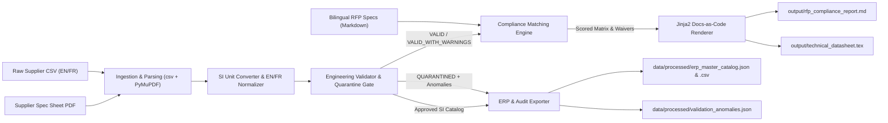

# Automated Technical RFP & Supplier Catalog Pipeline

[](https://www.python.org/)
[](https://docs.pydantic.dev/)
[](https://pymupdf.readthedocs.io/)
[](https://jinja.palletsprojects.com/)
[](https://docs.pytest.org/)
[](docs/architecture.md)
[](LICENSE)

> **Deterministic engineering data operations & Docs-as-Code pipeline** that ingests dirty bilingual (EN/FR) aerospace and industrial supplier catalogs (CSV + PDF), normalizes mixed imperial/metric specifications into canonical SI units with full audit traces, quarantines physically implausible or non-certified records, scores candidates against bilingual RFP requirements, and compiles ERP-ready JSON/CSV alongside executive Markdown and publication-grade LaTeX datasheets—in **~0.02 seconds** with **zero LLM calculation hallucinations**.

---

## Executive Summary

Aerospace and industrial procurement teams routinely lose hours reconciling heterogeneous supplier catalogs before an ERP import or a Request for Proposal (RFP) bid submission can proceed. Supplier files arrive with mixed imperial and SI units (`1/4"`, `3500 psi`, `-65 °F to 350 °F`, `0.65 oz`), French and English decimal conventions (`"10,0 mm"`, `"±0,03 mm"`, `"2 semaines"`), unstandardized alloy designations (`Ti-6Al-4V (Grade 5)` vs. `Titane Ti-6Al-4V`), and silent engineering defects (negative dimensions, out-of-spec tolerances, inverted thermal ranges, missing pressure ratings, or uncertified parts).

This project implements a **100% deterministic Python pipeline** (`src/pipeline.py`) designed around three operational guarantees:

1. **Zero Calculation Hallucinations:** Every unit conversion uses exact NIST/ISO constants (`1 in = 25.4 mm`, `1 psi = 0.006894757293168361 MPa`, `°C = (°F - 32) * 5/9`, `1 oz = 0.028349523125 kg`) and emits an immutable `UnitConversionTrace` audit record.
2. **Quarantine-by-Design Data Governance:** Records failing physical plausibility, category tolerance envelopes, deduplication, or aerospace certification checks (`AS9100D`, `EN 9100`, `NADCAP`, `AMS`, `NAS`) are deterministically isolated as `QUARANTINED` before RFP matching ever evaluates them.
3. **Single-Source Docs-as-Code Delivery:** One validated `PipelineReport` drives five synchronized artifacts: ERP master JSON/CSV, a machine-readable anomaly log, an executive Markdown compliance report, and a standalone LaTeX engineering datasheet rendered via custom Jinja2 delimiters (`\BLOCK{...}`, `\VAR{...}`).

In the live benchmark run (`RFP-AERO-2026-042`), the pipeline processed **56 raw records** (`50` CSV + `6` PDF), approved **43** (`41 VALID`, `2 VALID_WITH_WARNINGS`), quarantined **13** (`12` CSV + `1` PDF, flagging **16** total anomalies), evaluated **10** bilingual RFP requirements (`REQ-001`–`REQ-010`) with a **70.0%** full compliance rate (`7 COMPLIANT`, `2 PARTIAL_COMPLIANCE`, `1 NON_COMPLIANT`), and generated all five deliverables in **0.022s**.

---

## Résumé Exécutif (Français)

Les équipes d'ingénierie documentaire, d'opérations données (*Data Operations*) et de réponse aux appels d'offres (*RFP / Proposal Coordination*) dans l'aéronautique et l'industrie sont confrontées à un goulot d'étranglement critique : les catalogues fournisseurs arrivent sous forme de fichiers hétérogènes (CSV et fiches techniques PDF) mêlant unités impériales et métriques (`1/4"`, `3500 psi`, `-65 °F`, `0.65 oz`), conventions décimales anglophones et francophones (`"10,0 mm"`, `"±0,03 mm"`, `"2 semaines"`), désignations matériaux non normalisées et anomalies critiques (dimensions négatives, plages thermiques inversées, absence de certification `AS9100D` / `EN 9100`).

Ce projet implémente un **pipeline Python 100 % déterministe** (*Docs-as-Code*) offrant :

- **Normalisation SI traçable sans hallucination :** Conversion exacte selon les constantes NIST/ISO avec journal d'audit `UnitConversionTrace` par champ converti et traduction/normalisation bilingue **EN/FR** des descriptions, matériaux et délais.
- **Contrôle qualité et mise en quarantaine automatique :** Détection de **14 codes d'anomalies** (`AnomalyCode`), exclusion systématique des références non conformes (`QUARANTINED`) avant le matching appel d'offres, et conservation des alertes documentées (`VALID_WITH_WARNINGS`).
- **Génération multi-cibles à partir d'une source unique :** Export simultané des catalogues maîtres ERP (`JSON`/`CSV`), du registre d'anomalies, du rapport exécutif de conformité (`Markdown`) et d'une fiche technique d'ingénierie compilable en `LaTeX` (`\BLOCK{...}`, `\VAR{...}`, échappement mono-passe).

Sur le jeu de validation `RFP-AERO-2026-042`, le pipeline traite **56 références** (`50` CSV + `6` PDF), isole **13 articles en quarantaine** (**16 anomalies** tracées), évalue **10 exigences bilingues** (`REQ-001` à `REQ-010`) avec **70,0 % de conformité totale** (`7` conformes, `2` partielles, `1` non conforme) et produit les 5 livrables en **0,022 s** (contre ~6 heures de traitement manuel).

---

## Business Problem Solved

| Operational Pain Point | Manual / Ad-Hoc LLM Failure Mode | Deterministic Pipeline Solution |
| :--- | :--- | :--- |
| **Mixed Imperial & Metric Units** | Manual spreadsheet conversion errors (`in` vs `mm`, `psi` vs `MPa`, `°F` vs `°C`) or silent LLM arithmetic drift during RFP comparisons. | Exact NIST/ISO conversion constants in [`src/unit_converter.py`](src/unit_converter.py) with fractional (`1/4"`), EU comma-decimal (`10,0 mm`), and Kelvin/Fahrenheit parsing plus `UnitConversionTrace` audit records. |
| **Bilingual EN/FR Supplier Specs** | French supplier terms (`Fixation`, `Vanne`, `2 semaines`, `EN 9100`) fail naive English ERP keyword lookups and manual filters. | Deterministic EN/FR category/material mapping, language detection (`en`, `fr`, `bilingual`), lead-time normalization (`semaines` → days), and IAQG 9100 equivalence (`AS9100D` ≡ `EN 9100` ≡ `JISQ 9100`). |
| **Dirty Catalog Imports Breaking ERPs** | Duplicate part numbers, negative dimensions, inverted temperature ranges, or missing pressure ratings reach ERP staging tables or bid proposals. | Strict Pydantic v2 schema + 14-code engineering validator ([`src/validator.py`](src/validator.py)) segregating `QUARANTINED` records from `VALID` / `VALID_WITH_WARNINGS` parts. |
| **Slow RFP Bid Turnaround & Formatting** | Engineers spend hours cross-checking PDF spec sheets against RFP limits and reformatting Markdown/LaTeX tables by hand. | Automated multi-criteria scoring ([`src/compliance_matcher.py`](src/compliance_matcher.py)) and single-source Jinja2 rendering ([`src/doc_generator.py`](src/doc_generator.py)) with safe LaTeX escaping. |

---

## System Architecture



For full module-level internals, conversion constants, tolerance envelopes, IAQG 9100 equivalence rules, and LaTeX escaping mechanics, see [`docs/architecture.md`](docs/architecture.md). For field-level schemas and all 14 `AnomalyCode` definitions, see [`docs/data_dictionary.md`](docs/data_dictionary.md).

---

## Quantified Operational Impact & ROI

Metrics below reflect the verified execution of `RFP-AERO-2026-042` (`56` supplier records across CSV + PDF, `10` bilingual RFP requirements):

| Workflow Dimension | Manual Engineering Workflow | Automated Deterministic Pipeline | Verified Impact |
| :--- | :--- | :--- | :--- |
| **End-to-End Turnaround** | ~6 hours (unit conversion, PDF transcription, compliance matrix, LaTeX formatting) | **~0.02s–0.05s** (measured **`0.022s`** / `0.0224s` on `RFP-AERO-2026-042`) | **< 1 second** (>99.9% cycle-time reduction) |
| **SI Unit Conversion Accuracy** | Prone to copy-paste / decimal-comma / imperial-fraction errors | Exact NIST/ISO constants (`25.4`, `0.006894757...`, `0.45359237`) | **0 calculation hallucinations** |
| **Defect & Compliance Traceability** | Ad-hoc spreadsheet spot checks; quarantined defects easily overlooked | Automated evaluation of **14 `AnomalyCode` rules** (`16` anomalies caught; `13` quarantined) | **100% anomaly traceability** |
| **Bilingual EN/FR Reconciliation** | Manual lookup between `AS9100D` / `EN 9100`, French material notes, and `semaines` | Deterministic EN/FR normalizer + IAQG 9100 equivalence + lead-time conversion | **Zero manual translation bottlenecks** |
| **Deliverable Synchronization** | Separate manual edits across ERP CSV, Word/Markdown report, and LaTeX PDF | Single `PipelineReport` renders all **5 deliverables** atomically | **100% cross-document consistency** |

---

## Repository Structure

```text
automated-technical-rfp-catalog-pipeline/
├── data/
│   ├── raw/
│   │   ├── supplier_catalog_dirty.csv        # 50 dirty bilingual supplier rows (CSV)
│   │   ├── supplier_spec_sheet_dirty.pdf     # 6 supplemental supplier blocks (PDF)
│   │   └── rfp_requirements_sample.md        # 10 bilingual EN/FR RFP requirements (REQ-001..REQ-010)
│   └── processed/
│       ├── erp_master_catalog.json           # Normalized SI catalog + conversion traces + metadata
│       ├── erp_master_catalog.csv            # Flat 19-column ERP-ready SI export
│       └── validation_anomalies.json         # Summary counts & per-record anomaly audit log
├── docs/
│   ├── architecture.md                       # Deep-dive technical specification & algorithms
│   └── data_dictionary.md                    # Complete JSON/CSV schema & 14 AnomalyCode reference
├── output/
│   ├── rfp_compliance_report.md              # Executive Markdown RFP compliance report
│   └── technical_datasheet.tex               # Standalone landscape LaTeX SI engineering datasheet
├── scripts/
│   └── generate_synthetic_data.py            # Reproducible synthetic dirty dataset generator
├── src/
│   ├── __init__.py                           # Package metadata (__version__ = "1.0.0")
│   ├── models.py                             # Pydantic v2 domain models & enums
│   ├── unit_converter.py                     # NIST/ISO SI conversions, fractions, comma-decimals
│   ├── parser.py                             # CSV, PyMuPDF PDF, RFP Markdown, EN/FR normalizer
│   ├── validator.py                          # Physical plausibility, tolerance & certification gate
│   ├── compliance_matcher.py                 # Multi-criteria RFP scoring & IAQG 9100 equivalence
│   ├── doc_generator.py                      # ERP exporter + Jinja2 Markdown & LaTeX renderer
│   └── pipeline.py                           # Typer CLI & programmatic orchestrator
├── templates/
│   ├── rfp_compliance_report.md.j2           # Jinja2 template for executive compliance report
│   └── technical_datasheet.tex.j2            # Custom-delimiter Jinja2 LaTeX datasheet template
├── tests/                                    # Pytest unit, integration & LaTeX lint test suite
├── LICENSE                                   # MIT License
├── pyproject.toml                            # Package configuration, dependencies & pytest settings
├── requirements.txt                          # Core & test dependencies
└── README.md                                 # Project overview & portfolio documentation
```

---

## Installation & Usage Guide

### Prerequisites

- **Python 3.11+** (tested on Python 3.12)
- Dependencies: `pydantic>=2.0`, `pymupdf>=1.24`, `jinja2>=3.1`, `rapidfuzz>=3.0`, `typer>=0.12`, `rich>=13.0`, and `pytest>=8.0` for testing.

### Setup

**Windows (PowerShell):**

```powershell
git clone https://github.com/bernardoolivaaquino/automated-technical-rfp-catalog-pipeline.git
cd automated-technical-rfp-catalog-pipeline

py -3.12 -m venv .venv
.\.venv\Scripts\Activate.ps1
pip install -r requirements.txt
```

**Linux / macOS (Bash):**

```bash
git clone https://github.com/bernardoolivaaquino/automated-technical-rfp-catalog-pipeline.git
cd automated-technical-rfp-catalog-pipeline

python3 -m venv .venv
source .venv/bin/activate
pip install -r requirements.txt
```

*(Optional editable install for the `rfp-pipeline` console entrypoint: `pip install -e ".[dev]"`)*

### Running the Pipeline

Run with default repository paths (`data/raw/` → `data/processed/` and `output/`):

```powershell
# Windows (PowerShell)
py -3.12 -m src.pipeline
```

```bash
# Linux / macOS (or activated venv)
python -m src.pipeline
```

Run with custom input/output paths using Typer CLI flags:

```bash
python -m src.pipeline \
  --csv data/raw/supplier_catalog_dirty.csv \
  --pdf data/raw/supplier_spec_sheet_dirty.pdf \
  --rfp data/raw/rfp_requirements_sample.md \
  --processed-dir data/processed \
  --template-dir templates \
  --output-dir output
```

> **Note:** To compile `output/technical_datasheet.tex` to PDF locally, run `pdflatex -interaction=nonstopmode output/technical_datasheet.tex` (requires a TeX distribution such as TeX Live or MiKTeX; `technical_datasheet.tex` is already generated cleanly without requiring TeX to run the Python pipeline).

---

## Authentic Input → Output Walkthrough

The excerpts below are taken directly from the verified `RFP-AERO-2026-042` pipeline run.

### 1. Dirty Raw Input (`data/raw/supplier_catalog_dirty.csv`)

Notice the mixed imperial fractions (`1/4"`), imperial tolerances (`±0.001 in`), Fahrenheit ranges (`-65 °F to 350 °F`), ounce mass (`0.65 oz`), French decimal commas (`"10,0 mm"`, `"±0,03 mm"`), French lead times (`2 semaines`), and duplicate/invalid rows (`ti64-bolt-m8 `, `-5.0 mm`, `±0.65 mm`):

```csv
part_number,supplier_name,category_raw,description,material_spec,nominal_dim_raw,tolerance_raw,max_pressure_raw,operating_temp_raw,mass_raw,standards_raw,unit_price_usd,lead_time_days
TI64-BOLT-M8,AeroFix Precision SA,Fastener,Titanium hex head structural bolt for wing-spar attachment,Ti-6Al-4V,8.0 mm,±0.025 mm,,-60 °C to 220 °C,14.5 g,"AS9100D, AMS 4928, NASM21250",18.40,14
TI64-BOLT-M10,Safran Fixations Lyon,Fixation,Vis hexagonale structurale en titane pour longeron de voilure,Ti-6Al-4V (Grade 5),"10,0 mm","±0,03 mm",,-65 °C à 200 °C,24.2 g,"EN 9100, NASM21250, NADCAP",22.90,2 semaines
NAS-6204-12,Pacific Aerospace Fasteners,Aerospace Fasteners,Close-tolerance alloy steel shear bolt 1/4 inch shank,4340 Alloy Steel,"1/4""",±0.001 in,,-65 °F to 350 °F,0.65 oz,"AS9100D, NAS6204, MIL-S-5000",9.75,10
```

### 2. Normalized SI JSON with Conversion Audit Trail (`data/processed/erp_master_catalog.json`)

Every raw value is converted to canonical SI units with an explicit `UnitConversionTrace` and `PipelineMetrics`:

```json
{
  "metadata": {
    "rfp_id": "RFP-AERO-2026-042",
    "rfp_title": "Next-Generation Wing & Hydraulic Subassembly Procurement / Approvisionnement sous-ensembles voilure et hydraulique",
    "generated_at_utc": "2026-11-25T03:23:30Z",
    "total_components": 56,
    "approved_components_count": 43,
    "quarantined_components_count": 13,
    "metrics": {
      "total_raw_records": 56,
      "csv_records": 50,
      "pdf_records": 6,
      "valid_count": 41,
      "valid_with_warnings_count": 2,
      "quarantined_count": 13,
      "total_anomalies": 16,
      "total_requirements": 10,
      "compliant_count": 7,
      "partial_count": 2,
      "non_compliant_count": 1,
      "compliance_rate_pct": 70.0,
      "execution_time_seconds": 0.0224
    }
  }
}
```

Example normalized record (`NAS-6204-12`, converted from `1/4"`, `±0.001 in`, `-65 °F to 350 °F`, and `0.65 oz`):

```json
{
  "part_number": "NAS-6204-12",
  "supplier_name": "Pacific Aerospace Fasteners",
  "source_file": "supplier_catalog_dirty.csv",
  "source_type": "csv",
  "source_location": "row:3",
  "category": "FASTENER",
  "category_raw": "Aerospace Fasteners",
  "description_raw": "Close-tolerance alloy steel shear bolt 1/4 inch shank",
  "description_en": "Close-tolerance alloy steel shear bolt 1/4 inch shank",
  "language_detected": "en",
  "material_canonical": "4340 Alloy Steel",
  "material_raw": "4340 Alloy Steel",
  "nominal_dim_mm": 6.35,
  "tolerance_mm": 0.0254,
  "max_pressure_mpa": null,
  "temp_min_c": -53.888888889,
  "temp_max_c": 176.666666667,
  "mass_kg": 0.01842719,
  "standards": ["AS9100D", "NAS6204", "MIL-S-5000"],
  "unit_price_usd": 9.75,
  "lead_time_days": 10,
  "conversion_traces": [
    {
      "field": "nominal_dim",
      "raw_value": "1/4\"",
      "original_value": 0.25,
      "original_unit": "in",
      "si_value": 6.35,
      "si_unit": "mm",
      "conversion_factor_note": "1 in = 25.4 mm"
    },
    {
      "field": "tolerance",
      "raw_value": "±0.001 in",
      "original_value": 0.001,
      "original_unit": "in",
      "si_value": 0.0254,
      "si_unit": "mm",
      "conversion_factor_note": "1 in = 25.4 mm"
    },
    {
      "field": "temp_min",
      "raw_value": "-65 °F",
      "original_value": -65.0,
      "original_unit": "°F",
      "si_value": -53.888888889,
      "si_unit": "°C",
      "conversion_factor_note": "°C = (°F - 32) * 5/9"
    },
    {
      "field": "mass",
      "raw_value": "0.65 oz",
      "original_value": 0.65,
      "original_unit": "oz",
      "si_value": 0.01842719,
      "si_unit": "kg",
      "conversion_factor_note": "1 oz = 0.028349523125 kg"
    }
  ],
  "anomalies": [],
  "validation_status": "VALID"
}
```

### 3. Executive Compliance Report (`output/rfp_compliance_report.md`)

```markdown
## 2. Master Compliance Matrix

| REQ-ID | Title | Category | Status | Recommended P/N | Supplier | Score | Unit Price | Lead Time |
| :--- | :--- | :--- | :--- | :--- | :--- | ---: | ---: | ---: |
| REQ-001 | Primary Wing-Spar Titanium Hex Bolts | FASTENER | **COMPLIANT** | TI64-BOLT-M8 | AeroFix Precision SA | 100.0% | $18.40 | 14 d |
| REQ-002 | Vanne de régulation hydraulique haute pression | VALVE | **COMPLIANT** | VLV-REL-5000 | Valcor Flight Systems | 100.0% | $760.00 | 21 d |
| REQ-008 | Écrou autofreiné haute température pour train d'atterrissage | FASTENER | **PARTIAL_COMPLIANCE** | A286-NUT-M14 | AéroVisserie Toulouse | 87.5% | $16.80 | 21 d |
| REQ-009 | Ultra-High-Pressure Bleed-Air Isolation Valve | VALVE | **NON_COMPLIANT** | VLV-BLEED-320 | Turbine Hardware Corp | 55.6% | $1950.00 | 42 d |
```

### 4. Standalone LaTeX SI Datasheet (`output/technical_datasheet.tex`)

```latex
TI64-BOLT-M8 &
AeroFix Precision SA &
FASTENER &
Ti-6Al-4V &
8.00 &
$\pm$0.025 &
--- &
-60 to 220 &
0.015 &
AS9100D, AMS 4928, NASM21250 &
\textcolor{okgreen}{VALID} \\
NAS-6204-12 &
Pacific Aerospace Fasteners &
FASTENER &
4340 Alloy Steel &
6.35 &
$\pm$0.025 &
--- &
-54 to 177 &
0.018 &
AS9100D, NAS6204, MIL-S-5000 &
\textcolor{okgreen}{VALID} \\
```

---

## Testing & Quality Assurance

The repository includes an automated `pytest` test suite covering unit conversions, bilingual EN/FR normalization, validation/quarantine rules, IAQG 9100 compliance scoring, end-to-end pipeline execution, and programmatic LaTeX lint checks (balanced environments, balanced braces, zero unescaped `%`, `_`, `&`, and consistent table column counts).

Run the full verification suite:

```powershell
# Windows (PowerShell)
py -3.12 -m pytest -v
```

```bash
# Linux / macOS (or activated venv)
python -m pytest -v
```

**Latest Verified Result:** `163 passed` in `0.45s` (`0 failed`, `0 skipped`).

---

## License

Licensed under the [MIT License](LICENSE).
