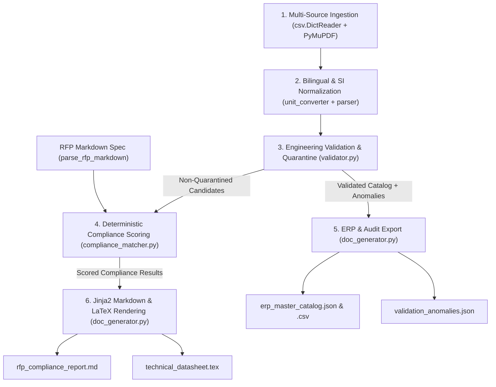

# System Architecture & Technical Specification

This document describes the internal architecture, deterministic algorithms, constants, and rendering safeguards of the **Automated Technical RFP & Supplier Catalog Pipeline** (`automated-technical-rfp-catalog-pipeline`).

---

## 1. End-to-End Data Flow

The pipeline orchestrator [`run_pipeline`](../src/pipeline.py) executes six deterministic stages in memory before writing five synchronized outputs:

All cross-stage payloads are strictly typed via **Pydantic v2** models defined in [`src/models.py`](../src/models.py):
`RawSupplierRecord` → `NormalizedComponent` → `RequirementComplianceResult` → `PipelineReport`.

---

## 2. Multi-Source Ingestion (`src/parser.py`)

### 2.1 CSV Ingestion (`parse_supplier_csv`)
- Reads supplier CSV files using Python's `csv.DictReader` with `encoding="utf-8-sig"` so UTF-8 BOM headers exported by Microsoft Excel are handled cleanly without polluting the `part_number` column key.
- Captures exact provenance (`source_file`, `source_type="csv"`, `source_location="row:<idx>"`, 1-based data row index) into `RawSupplierRecord`.

### 2.2 PDF Spec Sheet Extraction (`parse_supplier_pdf`)
- Opens supplemental supplier datasheets via **PyMuPDF** (`pymupdf.open(path)`), iterating page-by-page (`page.get_text("text")`).
- Detects component block boundaries via `_PDF_BLOCK_HEADER_RE` (`^---\s*Component Spec Block\s*#(\d+)\s*---\s*$`).
- Parses `Label: Value` lines using `_assign_pdf_field`, supporting both English and French field labels:
  - `part number` / `référence`
  - `supplier` / `fournisseur`
  - `category` / `catégorie`
  - `description`
  - `material` / `matériau`
  - `nominal dimension` / `dimension nominale`
  - `tolerance` / `tolérance`
  - `max pressure` / `pression max`
  - `operating temp` / `température`
  - `mass` / `masse`
  - `standards` / `normes`
  - `unit price` / `prix unitaire`
  - `lead time` / `délai`
- Records PDF provenance as `source_location="page:<page_idx>:block:<block_num>"`.

### 2.3 RFP Markdown Parsing (`parse_rfp_markdown`)
- Extracts `RFP ID` and `Title` from header bullets (`- **RFP ID:** ...`, `- **Title:** ...`) or fallback H1 (`# RFP-...: ...`).
- Splits requirements on `### REQ-<N>: <Title>` sections, extracts prose and `- Key: Value` bullets, converts every dimensional, tolerance, pressure, and temperature limit into SI units, and parses `Required Standards` into conjunctive/disjunctive groups (`;` = AND, `OR` = alternative equivalence within a group).

---

## 3. Deterministic NIST/ISO SI Unit Conversion (`src/unit_converter.py`)

### 3.1 Canonical Conversion Constants

All dimensional, pressure, mass, and thermal conversions use exact NIST/ISO constants rather than approximate multipliers:

| Domain | Canonical SI Unit | Exact Constants Defined in `src/unit_converter.py` |
| :--- | :--- | :--- |
| **Length & Tolerance** | `mm` | `INCH_TO_MM = 25.4`, `CM_TO_MM = 10.0`, `M_TO_MM = 1000.0`, `UM_TO_MM = 0.001` |
| **Pressure** | `MPa` | `PSI_TO_MPA = 0.006894757293168361`, `BAR_TO_MPA = 0.1`, `KPA_TO_MPA = 0.001`, `PA_TO_MPA = 1e-6`, `GPA_TO_MPA = 1000.0`, `KSI_TO_MPA = 6.894757293168361` |
| **Mass** | `kg` | `LB_TO_KG = 0.45359237`, `OZ_TO_KG = 0.028349523125`, `G_TO_KG = 0.001`, `MG_TO_KG = 1e-6` |
| **Temperature** | `°C` | `°C = (°F - 32.0) * 5.0 / 9.0`, `KELVIN_OFFSET = 273.15` (`°C = K - 273.15`) |
| **Lead Time** | `days` (`int`) | `d`/`day`/`days`/`j`/`jour`/`jours` = `1`, `w`/`wk`/`wks`/`week`/`weeks`/`sem`/`semaine`/`semaines` = `7`, `mo`/`month`/`months`/`mois` = `30` |

Values are rounded via `_clean_round(value, digits=9)` to suppress binary floating-point noise while preserving full NIST precision (and normalizing `-0.0` to `0.0`).

### 3.2 Number, Fraction & Locale Parsing (`parse_number`)
`parse_number` resolves heterogeneous numeric formats in deterministic order:
1. Strips optional leading `±` (used in tolerances) and collapses spaces after leading signs (e.g., `"- 5.0"`).
2. **Mixed fractions** (`_MIXED_FRACTION_RE`): e.g., `1 1/4` or `1-1/4` → `1.25` (rejects zero denominators with `UnitParseError`).
3. **Simple fractions** (`_SIMPLE_FRACTION_RE`): e.g., `1/4` or `3/4` → `0.25`, `0.75`.
4. **Locale decimal & thousands disambiguation** (applied to the mantissa before any `e`/`E` exponent):
   - Both `,` and `.` present: if `rfind(",") < rfind(".")`, treats `,` as English thousands separator (`1,250.00` → `1250.00`); otherwise treats `.` as European thousands separator and `,` as decimal (`1.250,50` → `1250.50`).
   - Only `,` present: multiple commas are stripped as thousands separators; a single comma is converted to `.` (`"10,0"` → `10.0`, `"24,0"` → `24.0`).

### 3.3 Compound Expressions & Audit Traces
- **Inline tolerances (`parse_length_to_mm`):** Splits expressions matching `_INLINE_TOL_RE` (`±`, `+/-`, `+-`), inheriting units symmetrically when one side omits a unit (e.g., `10.0 ± 0.05 mm`).
- **Temperature ranges (`parse_temp_range_to_c`):** Supports `to`, `à`, `/`, `–`, `—`, spaced `-`, and unit-anchored `-` (e.g., `-60 °C to 220 °C`, `-65 °C à 200 °C`, `-65 °F to 350 °F`, `210 K to 473 K`). The minimum endpoint inherits the maximum endpoint's unit if omitted.
- **Missing-value tokens:** `is_missing_value` treats `""`, `"n/a"`, `"na"`, `"tbd"`, `"none"`, `"-"`, `"—"`, `"–"` as absent (`None`), distinguishing missing fields from unparseable malformed strings (`UnitParseError` → `AnomalyCode.UNPARSEABLE_UNIT`).
- **Audit trail:** Every converted field appends a `UnitConversionTrace` (`field`, `raw_value`, `original_value`, `original_unit`, `si_value`, `si_unit`, `conversion_factor_note`) to `NormalizedComponent.conversion_traces`.

---

## 4. Bilingual EN/FR Normalization & Language Detection (`src/parser.py`)

- **Category Classification (`normalize_category`):** Evaluates `_CATEGORY_RULES` in deterministic priority order (`FASTENER`, `VALVE`, `ALLOY`, `SEAL`, `FITTING`, `ACTUATOR`, `SENSOR`), matching EN/FR terms (`Fixation`, `Visserie`, `Boulonnerie`, `Électrovanne`, `Vanne`, `Joint`, `Raccord`, `Capteur`, `Actionneur`, `Superalliage`). Falls back to description keywords only when `category_raw` is empty; unrecognized non-empty categories map to `ComponentCategory.UNKNOWN`.
- **Material Canonicalization (`normalize_material`):** Maps 50+ case-insensitive EN/FR material variants in `_MATERIAL_MAP` (e.g., `"Ti-6Al-4V (Grade 5)"` → `"Ti-6Al-4V"`, `"7075-T6"` / `"alliage 7075-t6"` → `"Aluminum 7075-T6"`, `"17-4PH"` / `"acier 17-4ph"` → `"17-4PH Stainless Steel"`, `"FVMQ"` → `"Fluorosilicone (FVMQ)"`), with secondary parenthetical UNS/grade stripping fallback.
- **Language Detection & Description Standardization (`standardize_description_en`):**
  - Detects bilingual slash-separated strings (`" / "`), returning the English segment and `language_detected="bilingual"`.
  - Detects French text via `_FRENCH_ACCENT_RE` (French diacritics) and `_FRENCH_WORDS_RE` (domain vocabulary), translating via longest-phrase-first `_FR_TO_EN_GLOSSARY` and setting `language_detected="fr"`.
  - Preserves English text with `language_detected="en"`.
- **Standards Normalization (`normalize_standards`):** Splits on `[;,/]+`, filters uncertified placeholders (`"non certifié"`, `"uncertified"`, `"tbd"`, `"n/a"`, etc.), normalizes `"AS 9100D"` → `"AS9100D"`, and deduplicates case-insensitively while preserving order.

---

## 5. Deterministic Engineering Validation & Quarantine Gate (`src/validator.py`)

`validate_catalog` inspects every `NormalizedComponent` and assigns `validation_status` based on anomaly severity:
- Any `ERROR` anomaly → **`QUARANTINED`** (excluded from RFP candidate evaluation).
- No `ERROR` anomalies, at least one `WARNING` → **`VALID_WITH_WARNINGS`** (eligible for RFP matching with catalog warning waiver notes).
- Zero `ERROR`/`WARNING` anomalies → **`VALID`**.

### Validation Rule Categories
1. **Deduplication:** Case-insensitive, trimmed `part_number` check against `seen_part_numbers`. Subsequent occurrences trigger `DUPLICATE_PART_NUMBER` (`ERROR`).
2. **Physical Plausibility:**
   - `nominal_dim_mm <= 0` → `NEGATIVE_OR_ZERO_DIMENSION` (`ERROR`)
   - `tolerance_mm < 0` → `TOLERANCE_OUT_OF_SPEC` (`ERROR`)
   - `max_pressure_mpa <= 0` → `NEGATIVE_PRESSURE` (`ERROR`)
   - `temp_min_c < -273.15` or `temp_max_c < -273.15` → `IMPLAUSIBLE_TEMP_BELOW_ABS_ZERO` (`ERROR`)
   - `temp_min_c >= temp_max_c` → `INVERTED_TEMP_RANGE` (`ERROR`)
3. **Category Tolerance Envelopes (`CATEGORY_MAX_TOLERANCE_MM`):**
   - `FASTENER`: `±0.15 mm`
   - `VALVE`, `FITTING`, `SEAL`, `ACTUATOR`, `SENSOR`: `±0.25 mm`
   - `ALLOY`: `±0.50 mm`
   - Exceeding the category envelope triggers `TOLERANCE_OUT_OF_SPEC` (`ERROR`).
4. **Completeness & Certification:**
   - Missing `nominal_dim_mm` (when not already flagged `UNPARSEABLE_UNIT`): `ERROR` for `FASTENER`, `ALLOY`, `FITTING`, `SEAL`; `WARNING` otherwise (`MISSING_DIMENSION`).
   - Missing `max_pressure_mpa`: `ERROR` for `VALVE`; `WARNING` for `FITTING` and `SEAL` (`MISSING_PRESSURE_FOR_FLUID_PART`).
   - Missing `material_canonical` → `MISSING_MATERIAL` (`WARNING`).
   - Missing `temp_min_c` or `temp_max_c` → `MISSING_TEMP_RANGE` (`WARNING`).
   - `category == UNKNOWN` → `UNKNOWN_CATEGORY` (`ERROR`).
   - Empty `standards` → `MISSING_CERTIFICATION` (`ERROR`); non-empty `standards` without any prefix in `RECOGNIZED_STANDARD_PREFIXES` (`AS9100`, `EN 9100`, `EN9100`, `ISO`, `AMS`, `NAS`, `MS`, `AS`, `NADCAP`, `MIL`, `DIN`, `ASTM`, `DO-160`, `SAE`, `ARP`) → `UNVERIFIED_QUALITY_STANDARD` (`WARNING`).

---

## 6. Compliance Scoring & IAQG 9100 Equivalence (`src/compliance_matcher.py`)

`match_requirements` filters catalog components by `comp.category == req.category` and excludes all `QUARANTINED` items (tracking `quarantined_excluded_count` for audit visibility).

### 6.1 Standards & Material Matching
- **IAQG 9100 Equivalence (`standard_matches`):** Compact uppercase tokens matching `_IAQG_9100_EQUIVALENTS` (`AS9100`, `AS9100C`, `AS9100D`, `EN9100`, `JISQ9100`) or prefixes `AS9100*`/`EN9100*`/`JISQ9100*` are treated as mutually equivalent.
- **Organization Prefix & Boundary-Safe Family Matching (`_prefix_family_match`):** Strips optional `"SAE "` prefix and matches boundary-safe standard families (e.g., `NAS` → `NAS6204`, `ISO 9001` → `ISO 9001:2015`, `AS4395` → `SAE AS4395`) while preventing false prefix collisions.
- **Material Matching (`material_matches`):** Evaluates case-insensitive exact equality, alphanumeric token-boundary containment, and `rapidfuzz.fuzz.token_set_ratio >= 85`.

### 6.2 Scoring, Status Classification & Ranking
For each active RFP criterion (material, nominal dimension range, max tolerance, min pressure, min/max operating temperatures, and each standards group):
- `compliance_score = round(100.0 * passed_count / total_count, 1)` (or `100.0` if `total_count == 0`).
- **Status thresholds:**
  - `passed_count == total_count` → `COMPLIANT`
  - `compliance_score >= 60.0` → `PARTIAL_COMPLIANCE`
  - `compliance_score < 60.0` → `NON_COMPLIANT`
- **Deterministic Candidate Ranking (`_candidate_sort_key`):** Sorts candidates by `(status_rank, -compliance_score, warning_penalty, len(discrepancies), unit_price_usd, lead_time_days)`, ensuring `VALID` parts beat `VALID_WITH_WARNINGS` parts on tied scores, followed by lowest price and shortest lead time.
- **Engineering Waiver Notes (`_build_waiver_notes`):** Automatically surfaces catalog warnings and evaluates near-miss waiver thresholds on `PARTIAL_COMPLIANCE` items (thermal shortfall `<= 50.0 °C`, tolerance excess `<= max_allowed_tolerance_mm`, pressure `>= 85%` of target, or certification CoC/NADCAP gaps).

---

## 7. Jinja2 Custom-Delimiter LaTeX Rendering (`src/doc_generator.py`)

Standard Jinja2 delimiters (`{{ ... }}` and ``) collide heavily with LaTeX braces (`\textbf{...}`, `\begin{longtable}{...}`). `generate_latex_datasheet` eliminates delimiter collisions using a dedicated Jinja2 `Environment`:

| Jinja2 Syntax Role | Custom Delimiter | Example in `templates/technical_datasheet.tex.j2` |
| :--- | :--- | :--- |
| **Control Blocks** | `\BLOCK{` ... `}` | `\BLOCK{for comp in approved_components}` |
| **Variable Interpolation** | `\VAR{` ... `}` | `\VAR{comp.part_number \| escape_latex}` |
| **Template Comments** | `\#{` ... `}` | `\#{ Single-line template note }` |

### Single-Pass LaTeX Escaping (`escape_latex`)
The `escape_latex` filter maps `None` or empty strings to `"---"` and compiles `_LATEX_ESCAPE_PATTERN` sorted **longest-key-first** so replacement braces, backslashes, and `$` math delimiters are never double-escaped:

- **LaTeX reserved characters:** `\` → `\textbackslash{}`, `&` → `\&`, `%` → `\%`, `$` → `\$`, `#` → `\#`, `_` → `\_`, `{` → `\{`, `}` → `\}`, `~` → `\textasciitilde{}`, `^` → `\textasciicircum{}`
- **Unicode SI & punctuation symbols:** `°C` → `\textdegree C`, `°` → `\textdegree `, `±` → `$\pm$`, `µ`/`\u03bc` → `$\mu$`, `≥` → `$\ge$`, `≤` → `$\le$`, `–` → `--`, `—` → `---`
